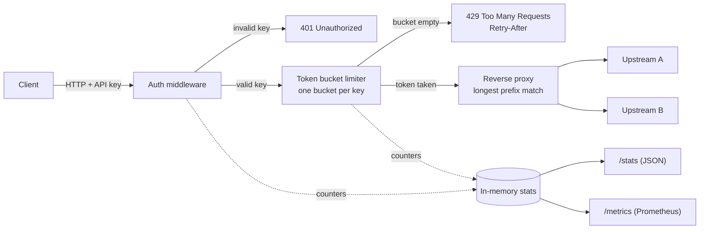

# api-gateway-ratelimit

[](https://github.com/taha080/api-gateway-ratelimit/actions/workflows/ci.yml)
[](LICENSE)

A small, fast, **100% free** API gateway written in Go. One static binary gives you API-key authentication, per-key token-bucket rate limiting, reverse proxying to upstreams defined in YAML, a usage stats endpoint and Prometheus metrics. No Redis, no paid services, and only one dependency (`gopkg.in/yaml.v3`).

**Live demo:** [Token Bucket Playground](https://taha080.github.io/api-gateway-ratelimit/) — move the sliders, fire requests, and watch `200` vs `429` responses in real time.

## Features

- **API-key auth** via `X-API-Key: <key>` or `Authorization: Bearer <key>`; unknown keys get `401`.
- **Token-bucket rate limiting per key** with configurable `rate` (tokens/second) and `burst` (bucket size).
- Standard headers: `X-RateLimit-Limit`, `X-RateLimit-Remaining`, and `Retry-After` on `429`.
- **Reverse proxy** with longest-prefix routing and optional prefix stripping; the client's API key is never forwarded upstream.
- **`/stats`** (authenticated JSON usage per client) and **`/metrics`** (Prometheus text format), plus `/healthz`.
- In-memory storage, so there is nothing to install or pay for.
- `${ENV_VAR}` expansion in the config so secrets stay out of git; honours `$PORT` for Render/Fly/Railway.
- Docker image built on distroless (about 10 MB), ready for the Render free plan.

## Architecture



### How the token bucket works

Each API key owns a bucket that holds up to `burst` tokens and refills at `rate` tokens per second. Every request takes one token. If the bucket is empty the gateway answers `429` and tells the client how many seconds to wait. This allows short bursts while enforcing a steady average rate.

## Project layout

```
cmd/gateway/         main program and end-to-end test
internal/auth/       API-key middleware
internal/ratelimit/  token bucket + per-key limiter
internal/proxy/      prefix router and reverse proxy
internal/stats/      counters and Prometheus output
docs/                GitHub Pages playground (static HTML/JS)
```

## Configuration

```yaml
listen: ":8080"

clients:
  - name: demo
    key: demo-key-123        # use ${ENV_VAR} to load secrets from the environment
    rate: 2                  # tokens refilled per second
    burst: 5                 # bucket capacity
  - name: partner
    key: ${PARTNER_API_KEY}
    rate: 10
    burst: 20

routes:
  - prefix: /httpbin/
    upstream: https://httpbin.org
    strip_prefix: true
  - prefix: /
    upstream: https://jsonplaceholder.typicode.com
```

Defaults: `rate: 5`, `burst: 10`, `listen: ":8080"`. If `PORT` is set it overrides `listen`.

## Run locally

Requires Go 1.22+.

```bash
git clone https://github.com/taha080/api-gateway-ratelimit.git
cd api-gateway-ratelimit
go test ./...
go run ./cmd/gateway -config config.yaml
```

## Docker

```bash
docker build -t api-gateway-ratelimit .
docker run -p 8080:8080 api-gateway-ratelimit
```

### Deploy on Render (free)

1. New → Web Service → connect this repo.
2. Runtime: **Docker**. Instance type: **Free**.
3. Add env var `PARTNER_API_KEY` (or edit `config.yaml`). Render sets `PORT` for you.

## curl examples

```bash
# 401 - no key
curl -i localhost:8080/todos/1

# 200 - proxied to jsonplaceholder
curl -i -H "X-API-Key: demo-key-123" localhost:8080/todos/1

# Bearer token also works, and /httpbin/ strips its prefix
curl -H "Authorization: Bearer demo-key-123" localhost:8080/httpbin/get

# Trigger 429: burst is 5, so the 6th quick request is limited
for i in $(seq 1 8); do
  curl -s -o /dev/null -w "%{http_code}\n" -H "X-API-Key: demo-key-123" localhost:8080/todos/1
done

# Usage stats and Prometheus metrics
curl -H "X-API-Key: demo-key-123" localhost:8080/stats
curl localhost:8080/metrics
```

Example `/metrics` output:

```
gateway_requests_total{key="demo",result="allowed"} 5
gateway_requests_total{key="demo",result="rate_limited"} 3
gateway_unauthorized_total 1
```

## Tests

```bash
go test -race -v ./...
```

Unit tests cover the token bucket (burst, refill, capacity cap, per-key isolation), the auth middleware (missing key, wrong key, header and bearer forms), the proxy (routing, prefix stripping, key not leaked, 404 and 502 cases) and an end-to-end gateway test (401 → 200 → 429 → metrics). CI runs them on every push.

## License

[MIT](LICENSE) © 2026 Taha Ahsan
